# My Money Tree

Welcome to your financial sanctuary.

My Money Tree is an Android personal budgeting and financial management application developed as the Part 2 prototype for a BCIS Software Development and Design module. The project builds on the Part 1B Planning and Design work, where the application was framed as a Financial Sanctuary: a calmer space for monitoring spending, managing savings goals and building healthier money habits.

This README documents the completed Part 3 application. It explains what the app does, how it is built, the two additional features developed for this submission, and how GitHub and GitHub Actions were used.

The full written report is here: [POE Part 3: Comprehensive Project Report](#poe-part-3-comprehensive-project-report).

Repository: https://github.com/DavidBarker05/OPSC7311_BudgetApp

## Contents

- [POE Part 3: Comprehensive Project Report](#poe-part-3-comprehensive-project-report)
- [Earlier submission documents](#earlier-submission-documents)
- [1. Introduction](#1-introduction)
- [2. Design concept](#2-design-concept)
- [3. Application functionality](#3-application-functionality)
- [4. Technical implementation](#4-technical-implementation)
- [POE Part 3: Two Additional Features](#poe-part-3-two-additional-features)
- [GitHub and GitHub Actions](#github-and-github-actions)
- [How to run the application](#how-to-run-the-application)
- [Scope and limitations](#scope-and-limitations)
- [Authors and project information](#authors-and-project-information)

The report is listed first so it is easy to open. Every link after it follows the order of this file.

## Earlier submission documents

These files were uploaded with the earlier parts of the portfolio. They are kept here so the development of the project can still be followed.

### Part 1

Research - [Research_OPSC7311_Part1A_Tiyah_Singh_ST10453245 (1).pdf](https://github.com/user-attachments/files/32261596/Research_OPSC7311_Part1A_Tiyah_Singh_ST10453245.1.pdf)

Planning and Design - [Planning & Design_OPSC7311_Part1B_Tiyah_Singh_ST10453245 (1).pdf](https://github.com/user-attachments/files/32261606/Planning.Design_OPSC7311_Part1B_Tiyah_Singh_ST10453245.1.pdf)

Gantt Chart - [OPSC7311_P1_Gantt_Chart_ST10453245_Tiyah_Singh (1).xlsx](https://github.com/user-attachments/files/32261612/OPSC7311_P1_Gantt_Chart_ST10453245_Tiyah_Singh.1.xlsx)

### Part 2

Code References and Bibliography List - [ST10453245_Code_References_Bibliography.pdf](https://github.com/user-attachments/files/32294733/ST10453245_Code_References_Bibliography.pdf)

Gantt Chart Project Schedule - [OPSC7311_P1_Gantt_Chart_ST10453245_Tiyah_Singh.xlsx](https://github.com/user-attachments/files/32295127/OPSC7311_P1_Gantt_Chart_ST10453245_Tiyah_Singh.xlsx)

Part 2 video demonstration - https://youtu.be/PVfXIFyZNoA

## 1. Introduction

Budgeting applications are widely available, but many still feel dense or stressful to use. That matters for students and young adults, where the difficulty is often not only knowing what to record, but being willing to open the app regularly.

My Money Tree keeps the practical parts of a budgeting tool: categories, amounts, dates, history, progress and clear navigation. It presents them in a quieter, nature-inspired interface. The Part 3 build adds online accounts, a working money-tree and watering-can progression, profile photograph cropping, and email password recovery.

The application is written in Kotlin and uses XML layouts. Accounts and financial records are stored with Firebase Authentication and Cloud Firestore. Receipt photographs stay on the device. The project is an academic submission, not a commercial product.

## 2. Design concept

### Financial Sanctuary

The Financial Sanctuary idea, carried forward from the Part 1B planning work, treats money management as something that should feel approachable. In the interface this appears through green and cream tones, garden-style category tiles, "Sow Expenses" wording, nature artwork on the splash and welcome screens, and a watering can for savings goals.

Progress is shown with budget bars, goal percentages, the watering-can fill and the money tree. The figures themselves stay visible. The tree and the can are a way of reading those figures, not a replacement for them.

### What was taken from the Part 1 research

The Part 1 comparison looked at YNAB, Wallet by BudgetBakers and Spendee. The patterns kept from that work are:

- structured expense categories
- transaction history that can be filtered
- clear amounts, dates and progress
- simple movement between tracking, review and goals

The presentation is organised around growth and a garden, rather than a plain list of transactions.

### Gamification

Gamification is a Part 3 requirement of its own. It is not one of the two additional features described later in this README.

Each user has one money tree, stored separately from the profile. Each savings goal has its own watering can. Money added to a goal since that can was last poured fills the can. The can can be poured once the unpoured amount reaches the goal's target. A goal with no target can be poured once any contribution is waiting. Pouring a full can raises the shared tree by one level and empties that can.

`GoalTreeGame` holds these rules. Level 1 is a seed, then sprout, sapling and young tree. From level 5 the picture stays a mature tree while the level can keep rising. `WateringCanActivity` shows the can that will be poured and the current tree through `WateringCanView` and `MoneyTreeView`. The tree state is read and updated through `UserTreeDatabaseSystem`.

## 3. Application functionality

### Accounts

A new account is created with a display name, email address, phone number, date of birth, password and currency. Sign-in uses the email address and password. Firebase Authentication keeps the credentials. The app stores the profile and the financial records in Cloud Firestore under that user's id, so one person's records are not mixed with another's.

After sign-in, the profile can be edited. The display name, phone number and currency can be changed from Edit Profile. Email and password changes each open their own screen, because they are checked again with Firebase. The account can be deleted from Edit Profile after a confirmation.

The signed-in user is remembered by Firebase, including after the app is closed. Signing out calls `FirebaseAuth.signOut()`.

Facebook and Google buttons are still placeholders. They show a short message and do not create an account.

### Categories, expenses and income

The first time the category garden is opened for an account that has none of the usual categories, the app creates Food, Transport, Medicine, Groceries, Rent, Gifts and Entertainment. Savings is not one of those defaults, because savings are tracked as goals. Categories can be added, renamed, given a different icon, given a monthly limit, or deleted.

Expenses and income can be recorded with a description, an amount, a category, a date, and a start and end time chosen by the user. An expense can also have a receipt photograph from the gallery or the camera. Saved expenses and income can be edited or deleted. Amounts may be typed with a currency symbol. The symbol is removed before the number is stored. Receipt files are kept in the app's private storage through `LocalImageStorageSystem`, and the transaction stores the path.

Home, the transaction list, search and category detail can filter what is shown by period, category and whether the record is income or an expense.

### Monthly goals and savings goals

The monthly goal is a minimum and a maximum for total spending in the month. It is separate from a limit set on one category, and separate from the money tree.

Budget bars on Home, Categories, Category Detail, the watering can and Analysis use the current month. On Home, the Daily, Weekly and Monthly control updates both the totals and the list under them.

Savings goals are created by the user. There is no fixed set of Travel, Wedding or Car goals. A goal has a name, an icon and an optional target. Contributions can be added or removed. Home and Quickly Analysis use those contribution figures for the savings summaries.

### Analysis

The app includes:

- a home dashboard with period totals and recent activity
- a transaction history with month and type filters, including edit and delete
- Analysis, with period totals, a chart and monthly budget progress
- Quickly Analysis, with a savings snapshot and a weekly expense graph
- search by text, category, type and date
- an in-app list of recent activity and reminders

Amounts are shown with `MoneyFormatter`. Incomplete or invalid input is rejected with a Toast rather than saved.

## 4. Technical implementation

### Platform

| Area | Details |
| --- | --- |
| Language | Kotlin 2.2.10 |
| UI | XML layouts and Material 3 (`Theme.Material3.Light.NoActionBar`) |
| Structure | Activities call manager classes. Managers talk to Firebase |
| Accounts | Firebase Authentication |
| Records | Cloud Firestore |
| Profile photograph | Cropped, compressed, then stored as a Firestore Blob |
| Receipts | Private on-device files through `LocalImageStorageSystem` |
| Concurrency | Kotlin coroutines |
| SDK | minSdk 26, targetSdk 36, compileSdk 37 |
| Build | Android Gradle Plugin 9.2.1, Java 11 bytecode, JDK 21 in CI |
| Firebase | BoM 34.19.0 (`firebase-auth`, `firebase-firestore`, `firebase-analytics`) |
| Image cropper | `com.vanniktech:android-image-cropper` 4.7.0, imported as `com.canhub.cropper` |

The project does not use Jetpack Compose. Room was considered in the Part 1 planning and is not the database used by this build. Firestore security rules allow a signed-in user to read and write only the documents under their own `users/{uid}` path. Phone numbers used at registration are stored so the same number cannot be registered twice.

`BudgetTreeApplication` creates the manager classes and the local image store when the process starts. Instrumented tests can replace those objects so a test does not write to the live project.

### Main data

| Record | Role |
| --- | --- |
| `User` | Profile fields for the signed-in account |
| `UserPhoto` | The profile image, in its own document so it is not downloaded on every login |
| `Category` | Name, icon and optional monthly budget |
| `Expense` and `Income` | Transactions, including date, times and an optional local image path |
| `MonthlyGoal` | Minimum and maximum spend for a month |
| `SavingsGoal` and `SavingsContribution` | A named goal, its target, and the amounts added to it |
| `UserTree` | The shared tree's level and the last time it was watered |

Dates and times are stored as ISO-8601 strings. Schema changes are no longer handled by wiping a local SQLite file, which was the case in the Part 2 Room prototype.

## POE Part 3: Two Additional Features

The brief asks for at least two features of our own, documented clearly enough that a lecturer knows what to look for. The two features are profile image cropping and email password recovery. Gamification, covered above, is a separate Part 3 requirement.

The same two features are discussed again in the full report. This section is the short technical guide to the code that implements them.

### Feature 1: Profile image cropping

The profile photograph is cropped before it is saved, so a gallery picture or a camera picture can be framed as a square avatar instead of being stored as whatever shape the file happened to have.

The user opens Profile, then Edit Profile, and taps the photograph. A dialog offers an upload from the gallery or a new photo from the camera. The gallery uses `ActivityResultContracts.GetContent` with `image/*`. The camera uses `TakePicture` and a `FileProvider` path. Camera permission is requested only when the user chooses that option.

`EditProfileActivity.startCrop` then opens the CanHub cropper through `CropImageContract`. The crop is a fixed 1:1 rectangle with the guidelines turned on. It is not an oval crop. An oval result has transparent corners, and those corners turn black when the file is saved as a JPEG. Flipping is turned off. The cropper writes a JPEG at quality 90.

Only the cropped file is passed on. `ProfilePhoto.compress` shrinks the longest side to 512 pixels and compresses it again as a JPEG at quality 85, so the image can fit in a Firestore document. `UserDatabaseSystem.updateProfilePhoto` rejects an empty file and anything over 500 KB. An accepted image is written as a Blob to `users/{uid}/profilePhoto/photo`. Removing the photograph deletes that document. `ProfilePhoto.bind` draws the saved bytes in the profile image view, or the default profile icon when there is no photograph.

Cancelling the cropper does nothing. Any other crop error shows the crop-failed message. The saved photograph is available on another sign-in of the same account because it lives in Firestore with the profile, unlike a receipt, which stays on the phone that took it.

### Feature 2: Email-based password recovery

A user who has forgotten their password can request a reset email without the app ever seeing the new password.

On the sign-in screen, Forgot Password opens `ForgotPasswordActivity`. The screen asks for an email address. An empty address shows "email required" and does not call Firebase. `UserDatabaseSystem.sendPasswordRecoveryEmail` also rejects a blank value and any string that does not match an email address. A valid address is passed to `FirebaseAuth.sendPasswordResetEmail`. Firebase sends a link to a page it hosts, where the user chooses the new password and then signs in with it.

If the call succeeds, the app opens `RecoverySentActivity` and shows the address that was entered. "Send again" stays disabled for 60 seconds, including if the phone is rotated, so the button cannot be used to send a stream of messages. The success message does not say that an account with that address definitely exists. With Firebase email enumeration protection, an unknown address can still return success and send nothing. Saying "if an account exists" avoids confirming which addresses are registered.

No internet connection and too many requests are caught separately and shown as Toasts. The button is disabled while the request is in progress and enabled again when it finishes. The Facebook and Google buttons on this screen are the same placeholders as on sign-in.

Changing a password while already signed in is a different screen, `NewPasswordActivity`. It is not this recovery flow.

## GitHub and GitHub Actions

### Version control

The project is hosted at [DavidBarker05/OPSC7311_BudgetApp](https://github.com/DavidBarker05/OPSC7311_BudgetApp). `master` is the branch that holds the submitted code. Work was done on feature branches such as `david` and `jamie`, then brought in through pull requests. The history includes merged pull requests from David Barker, Jamie-Lee Davies and Tiyah Singh. Recent examples are pull request 42, merged from `jamie`, and pull request 43, merged from `david`.

Git records the Kotlin classes, XML layouts, Firestore rules, tests and this README. A change to a manager can affect a form, a calculation and a test, so the commit history is the record of how those pieces moved together. Tags `part-2` and `summative` mark earlier points in that history.

### The Tests workflow

GitHub Actions is configured in `.github/workflows/tests.yml`. The workflow is named Tests. It runs on a push to `master` and on a pull request aimed at `master`.

Two jobs run.

The first job, `build-and-unit-test`, checks out the repository, sets up Temurin JDK 21 and Gradle, builds the debug APK with `./gradlew assembleDebug`, and runs the local unit tests with `./gradlew testDebugUnitTest`. Those tests do not need a phone. They cover formatting, budget status, category ordering, icons, monthly goal figures, analysis periods, the money-tree rules and the spending dashboard.

The second job, `instrumented-test`, runs three suites on an Android emulator (API 34, Pixel 6). A script, `.github/scripts/run-instrumented-tests.sh`, starts each suite:

| Suite | Package | Firebase emulators |
| --- | --- | --- |
| database | `com.example.mybudgettree.database` | Auth and Firestore |
| image storage | `com.example.mybudgettree.imagestorage` | not used |
| ui | `com.example.mybudgettree.ui` | Auth and Firestore |

The database and UI suites run inside `firebase emulators:exec`, using `firebase.json` and `firestore.rules`, so the tests can create accounts and records and then throw them away. The image-storage suite checks local files only. Each suite uploads its report as a build artefact, including when the suite fails. The three suites use `fail-fast: false`, so one failure does not cancel the other two.

The latest Tests run on `master`, for the merge of pull request 43, completed successfully on 26 October 2026. An earlier run on the `jamie` branch failed on 23 October 2026. A later run of that branch succeeded before it was merged. This README does not claim that every historical run passed.

Locally, the same checks are:

```bash
./gradlew testDebugUnitTest
./gradlew connectedDebugAndroidTest
```

The connected task needs a device or emulator. The database and UI packages also need the Auth and Firestore emulators if they are run the way CI runs them.

## How to run the application

Requirements:

- Android Studio with an SDK that can compile API 37
- an emulator or a device on API 26 or higher
- a JDK suitable for the Android Gradle Plugin (the workflow uses JDK 21)
- the Firebase configuration already in `app/google-services.json`

Steps:

```bash
git clone https://github.com/DavidBarker05/OPSC7311_BudgetApp.git
```

1. Open the project in Android Studio and let Gradle sync.
2. Select an emulator or a device.
3. Run the debug configuration.

On first launch the app moves from the splash screen to the welcome screen, then to sign up or sign in. The camera permission is asked for only when a photograph is taken. After sign-in, a useful walkthrough is:

1. Open the category garden and edit or add a category, including a monthly limit.
2. Add an expense with a date, start and end times, and an optional receipt.
3. Set a monthly goal with a minimum and a maximum.
4. Create a savings goal, add a contribution, and pour a full watering can onto the tree.
5. From Edit Profile, choose a photograph and crop it before it is saved.
6. From the sign-in screen, open Forgot Password and submit an email address.
7. Use Home, the transaction list and Analysis to check the same records.

The Part 3 demonstration video is linked from the report section below.

## Scope and limitations

This submission includes:

- account registration, sign-in, sign-out and account deletion through Firebase Authentication
- create, edit and delete for categories, expenses and income
- receipt photographs stored on the device
- a monthly minimum and maximum, and per-category monthly limits
- savings goals, contributions, watering cans and one shared money tree
- profile photograph cropping, with the saved photograph stored in Cloud Firestore
- email password recovery
- Firestore security rules that limit each user to their own documents
- GitHub history, pull requests and the Tests workflow

The limits that are still real:

- Facebook and Google sign-in are not implemented.
- The in-app notification list is not a push-notification service.
- Receipt photographs do not follow the user to another phone. The transaction can sync, but the file stays on the device that stored it.
- A profile photograph has to stay under 500 KB because it is a Firestore document, and a Firestore document cannot exceed 1 MiB.
- The app is an academic build. It is not published on the Play Store.

## Authors and project information

| Field | Details |
| --- | --- |
| Project | My Money Tree |
| Team | David Adam Barker, Jamie-Lee Davies, Tiyah Singh |
| Institution | Vega School / EMERIS |
| Programme | BCIS in Software Development and Design |
| Module | OPSC7311 |
| Stage | Part 3, completed application |
| Application ID | `com.example.mybudgettree` |
| Version | 1.0 |
| Repository | https://github.com/DavidBarker05/OPSC7311_BudgetApp |

The Harvard reference list for the written report is at the end of the next section. It was not shortened here.

## POE Part 3: Comprehensive Project Report

**Table of Contents**

- [Introduction](#report-introduction)
- [Purpose](#report-purpose)
- [Research foundation and design considerations](#report-research-foundation-and-design-considerations)
  - [Findings from Part 1A](#report-findings-from-part-1a)
  - [The Financial Sanctuary concept](#report-the-financial-sanctuary-concept)
  - [User experience, accessibility and intended audience](#report-user-experience-accessibility-and-intended-audience)
- [Application functionality and interface design](#report-application-functionality-and-interface-design)
  - [Accounts and user-specific records](#report-accounts-and-user-specific-records)
  - [Expense and income management](#report-expense-and-income-management)
  - [Categories, budgets and spending goals](#report-categories-budgets-and-spending-goals)
  - [Savings and financial progress](#report-savings-and-financial-progress)
- [Two additional application features](#report-two-additional-application-features)
  - [Additional Feature 1: Profile picture cropping](#report-additional-feature-1-profile-picture-cropping)
    - [Purpose and Design Considerations](#report-purpose-and-design-considerations)
    - [Image Selection and Cropping Implementation](#report-image-selection-and-cropping-implementation)
    - [Third-Party Library Integration](#report-third-party-library-integration)
    - [Image Compression and Validation](#report-image-compression-and-validation)
    - [Cloud Firestore and Profile Integration](#report-cloud-firestore-and-profile-integration)
    - [Error Handling and Testing](#report-error-handling-and-testing)
  - [Additional Feature 2: Email-based password recovery](#report-additional-feature-2-email-based-password-recovery)
    - [Purpose and Design Considerations](#report-purpose-and-design-considerations-2)
    - [Password Recovery Process](#report-password-recovery-process)
    - [Firebase Authentication Integration](#report-firebase-authentication-integration)
    - [Input Validation and Security Considerations](#report-input-validation-and-security-considerations)
    - [Application Implementation](#report-application-implementation)
    - [Contribution to Application Usability and Security](#report-contribution-to-application-usability-and-security)
- [Technical architecture and data management](#report-technical-architecture-and-data-management)
- [Utilisation of GitHub: collaboration and version control](#report-utilisation-of-github-collaboration-and-version-control)
- [Utilisation of GitHub Actions: automated build and testing](#report-utilisation-of-github-actions-automated-build-and-testing)
- [Final demonstration video and project resources](#report-final-demonstration-video-and-project-resources)
- [Conclusion](#report-conclusion)
- [References](#report-references)**List of figures**

*Figure 1. Screenshot of the application icon (Barker, Davies and Singh, 2026a).*

*Figure 2. Screenshot of the splash screen (Barker, Davies and Singh, 2026b).*

*Figure 3. Screenshot of the home dashboard (Barker, Davies and Singh, 2026c).*

*Figure 4. Screenshot of the shared Money Tree (Barker, Davies and Singh, 2026d).*

*Figure 5. Screenshot of the goal watering can (Barker, Davies and Singh, 2026e).*

*Figure 6. Screenshot of the Create Account screen (Barker, Davies and Singh, 2026f).*

*Figure 7. Screenshot of the sign-in screen (Barker, Davies and Singh, 2026g).*

*Figure 8. Screenshot of the analysis income and expense graph (Barker, Davies and Singh, 2026h).*

*Figure 9. Screenshot of the transaction list (Barker, Davies and Singh, 2026i).*

*Figure 10. Screenshot of category spending over a selected period, with minimum and maximum goals (Barker, Davies and Singh, 2026j).*

*Figure 11. Screenshot of a past month compared with the minimum and maximum (Barker, Davies and Singh, 2026k).*

*Figure 12. Screenshot of the Category Garden (Barker, Davies and Singh, 2026l).*

*Figure 13. Screenshot of the Quickly Analysis expense graph (Barker, Davies and Singh, 2026m).*

*Figure 14. Screenshot of profile photograph selection (Barker, Davies and Singh, 2026n).*

*Figure 15. Screenshot of the profile photograph crop (Barker, Davies and Singh, 2026o).*

*Figure 16. Screenshot of the saved profile photograph (Barker, Davies and Singh, 2026p).*

*Figure 17. Screenshot of the password recovery screen (Barker, Davies and Singh, 2026q).*

*Figure 18. Screenshot of the Firebase Authentication console (Barker, Davies and Singh, 2026r).*

*Figure 19. Screenshot of the Cloud Firestore console (Barker, Davies and Singh, 2026s).*

*Figure 20. Screenshot of the GitHub commit history (Barker, Davies and Singh, 2026t).*

*Figure 21. Screenshot of the GitHub Actions checks (Barker, Davies and Singh, 2026u).*

<a id="report-introduction"></a>

### Introduction

*MyMoneyTree* is a Kotlin based Android budgeting application designed to help users track expenses, manage budgets, monitor savings and develop healthier financial habits through an intuitive, visually engaging interface (Android Developers, 2026h). Developed as a therapeutic alternative to traditional budgeting applications, it combines practical financial tools with a nature-inspired Financial Sanctuary to make money management less intimidating and more rewarding (Rizwan, Malik and Hussain, 2026).

The application's design was informed by comparative research on *YNAB, Wallet by BudgetBakers* and Spendee (YNAB, 2024; BudgetBakers, 2026; Spendee, 2026b), highlighting the importance of structured budgeting, financial analysis and intuitive navigation. *MyMoneyTree* incorporates these principles alongside gamification and personalized financial progress. It uses Firebase Authentication and Cloud Firestore for account management and online data storage (Firebase, 2026a; 2026c), with GitHub and GitHub Actions supporting collaborative development, version control and automated testing (GitHub, 2026a; 2026b).

<a id="report-purpose"></a>

### Purpose

The purpose of *MyMoneyTree* is to provide users with a personalised financial sanctuary where they can manage expenses, monitor budgets and track savings in a serene, intuitive and visually engaging environment. As a therapeutic alternative to traditional budgeting applications, it aims to make financial management less intimidating while encouraging healthier and more consistent financial habits (Adepeju, et al., 2023; Rodríguez-Correa, et al., 2025).

Through nature inspired visual feedback, personalised savings goals and gamification, MyMoneyTree transforms financial progress into a more meaningful and rewarding experience. The Money Tree growth concept reinforces the idea that financial wellbeing develops gradually through consistent decisions and positive habits (Mubashar and Sarwar, 2025; Rizwan, Malik and Hussain, 2026). Ultimately, the application aims to empower users to understand their financial behaviour, take greater control of their finances and approach money management with confidence rather than stress.  Figures 1 to 3 show the application icon, the splash screen and the Home dashboard.

<p align="center">
  
</p>

*Figure 1. Screenshot of the application icon for My Money Tree (Barker, Davies and Singh, 2026a).*

<p align="center">
  
</p>

*Figure 2. Screenshot of the splash screen with the MyMoneyTree logo and tagline (Barker, Davies and Singh, 2026b).*

<p align="center">
  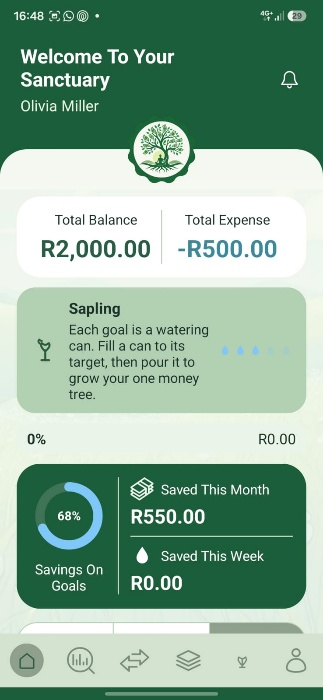
</p>

*Figure 3. Screenshot of the home dashboard showing balance totals and savings progress (Barker, Davies and Singh, 2026c).*

<a id="report-research-foundation-and-design-considerations"></a>

### Research foundation and design considerations

<a id="report-findings-from-part-1a"></a>

#### Findings from Part 1A

The research phase compared three established budgeting applications: *You Need a Budget (YNAB), Wallet by BudgetBakers* and *Spendee*. Each demonstrated a different strength that informed the proposed solution (YNAB, 2024; BudgetBakers, 2026; Spendee, 2026b).

*YNAB* was identified as particularly strong in structured budgeting and deliberate financial planning. Wallet demonstrated the value of comprehensive financial reporting, spending analytics and organized records. *Spendee* illustrated how intuitive navigation and visual presentation can make financial tracking more accessible, especially to users who may not be experienced with budgeting software (Spendee, 2026a).

The research also identified a tension between functionality and approachability. Highly structured budgeting methods may involve a learning curve, while information-heavy reporting interfaces can overwhelm users who want a straightforward understanding of their finances. Conversely, a visually appealing interface without meaningful financial information would offer limited practical value. The conclusion of Part 1A was therefore not to reproduce any one competitor, but to combine structured financial management, readable analysis and intuitive interaction (Spendee, 2026a).

| Application studied | Relevant strength | Influence on MyMoneyTree |
| --- | --- | --- |
| **YNAB** | Intentional, structured budgeting | Clear spending goals and purposeful financial planning |
| **Wallet by BudgetBakers** | Transaction organization and financial analysis | Financial summaries and spending review |
| **Spendee** | Approachable presentation and navigation | Intuitive, visually cohesive interface |

*Table 1. Research findings translated into design priorities*

<a id="report-the-financial-sanctuary-concept"></a>

#### The Financial Sanctuary concept

<p align="center">
  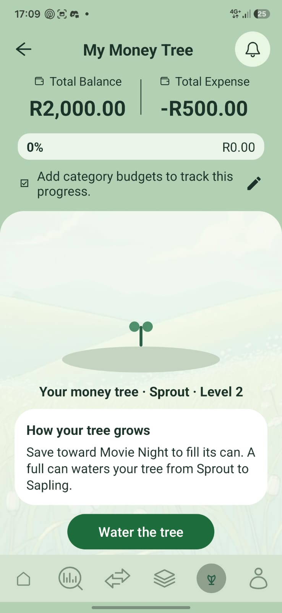
</p>

*Figure 4. Screenshot of the Goals tab showing the shared Money Tree (Barker, Davies and Singh, 2026d).*

<p align="center">
  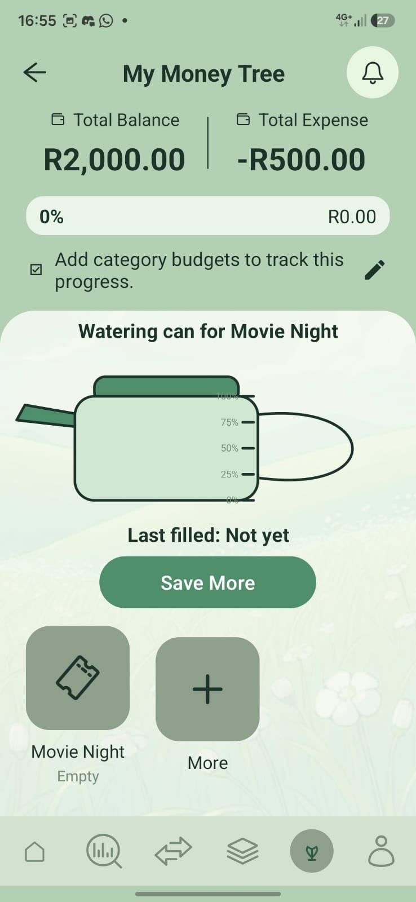
</p>

*Figure 5. Screenshot of the Goals tab scrolled to a goal's watering can (Barker, Davies and Singh, 2026e).*

Part 1B introduced the Financial Sanctuary, a personalised environment that represents budgeting as an ongoing process of care and growth. The botanical visual identity uses greens, cream backgrounds, garden-inspired icons and nature-related language to soften an activity that users may otherwise associate with stress (Mubashar and Sarwar, 2025).

The garden metaphor is applied to practical parts of the application. Categories are presented in a garden-inspired format; savings goals are associated with the Watering Can; and the Money Tree concept represents long-term progression. This gives the application a recognisable identity while reinforcing the idea that financial improvement happens through consistent, manageable actions. Figures 4 and 5 show the shared Money Tree and, further down the same screen, a goal’s watering can.

The design deliberately retains precise figures. Decorative progress visuals are not a substitute for transaction amounts, budget limits, dates or savings totals. Users still need to understand what they have spent, where the spending occurred and how it compares with their goals. The visual theme is therefore intended to support comprehension and motivation, not conceal unfavourable financial information (Android Developers, 2026k).

<a id="report-user-experience-accessibility-and-intended-audience"></a>

#### User experience, accessibility and intended audience

The intended audience includes students, young adults and individuals who want a less intimidating way to organise personal finances (Rodríguez-Correa, et al., 2025). The interface prioritises familiar navigation (Android Developers, 2026j), readable financial summaries, direct data-entry forms and visible progress indicators. Editable categories and savings goals allow the experience to reflect individual circumstances rather than forcing every user into the same budget structure.

The Android interface uses XML layouts, Activities, Material components and custom views (Android Developers, 2026g; 2026i; Material Components, 2026). Its consistent colour palette and iconography support recognition between screens. Form validation and user feedback are important design considerations because an attractive interface cannot be considered user-friendly if invalid amounts, missing fields or failed database requests cause confusion (Android Developers, 2026k).

The transition from the Part 1 design proposal to the Android implementation required several architectural decisions. The initial planning explored Room and SQLite as local persistence solutions (Android Developers, 2026e; 2026l); the developed architecture instead employs Firebase Authentication and Cloud Firestore for account-based access and online storage of structured financial information (Firebase, 2026a; 2026c). Android Activities and XML layouts were selected for screen composition (Android Developers, 2026g; 2026i). These decisions support a centralised user data model and enable the botanical visual identity to be implemented consistently across the application.

<a id="report-application-functionality-and-interface-design"></a>

### Application functionality and interface design

<a id="report-accounts-and-user-specific-records"></a>

#### Accounts and user-specific records

<p align="center">
  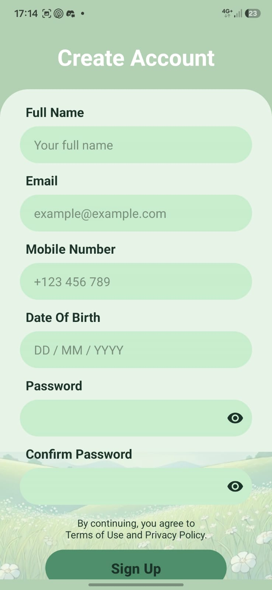
</p>

*Figure 6. Screenshot of the Create Account screen (Barker, Davies and Singh, 2026f).*

<p align="center">
  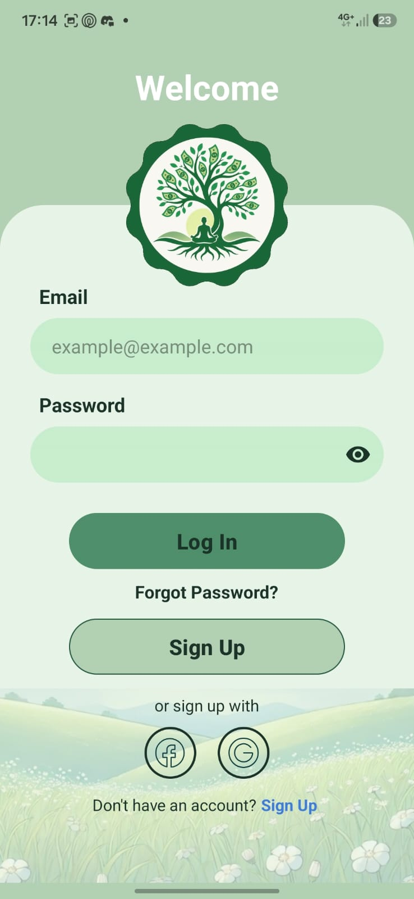
</p>

*Figure 7. Screenshot of the sign-in screen. Firebase Authentication holds the email and password (Barker, Davies and Singh, 2026g).*

Users can register and sign in with an email address and password through Firebase Authentication. Account details are maintained separately from financial transactions. Once authenticated, the Firebase user ID (uid) is used to associate the user's categories, transactions, budgets, savings goals and profile data with their account (Firebase, 2026e). Figures 6 and 7 show account creation and sign-in.

Profile management supports editing personal details, updating the password while signed in, requesting verification for an email change, selecting a profile image and confirming account deletion. A signed-in password change is not the same operation as recovering a forgotten password (Firebase, 2026e).

<a id="report-expense-and-income-management"></a>

#### Expense and income management

<p align="center">
  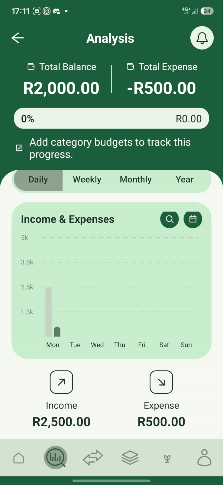
</p>

*Figure 8. Screenshot of the analysis screen with income and expenses graphed over a selected period (Barker, Davies and Singh, 2026h).*

<p align="center">
  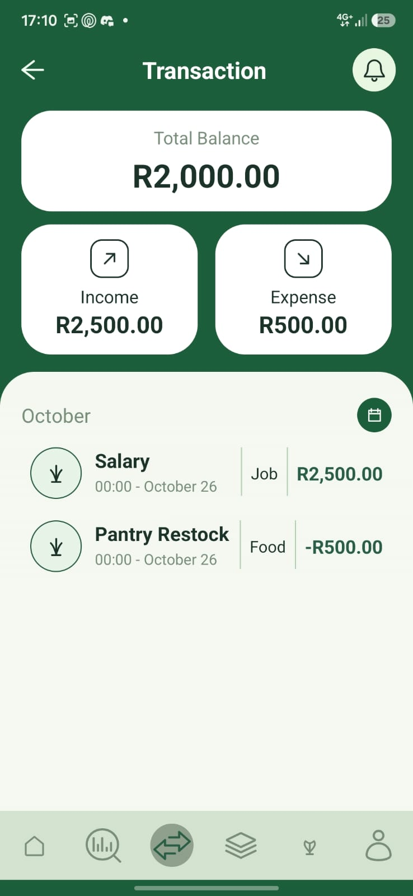
</p>

*Figure 9. Screenshot of the transaction list for the same period (Barker, Davies and Singh, 2026i).*

Users can create, edit and delete financial records with a description, amount, category, date and selected start/end times. Expenses may include a receipt or supporting photograph selected from the device or captured with the camera. Transaction history, search and period-based review help users revisit previous entries and identify spending patterns. Figures 8 and 9 show income and expenses graphed over a selected period, and the transaction list those totals come from.

The financial record is stored in Firestore. Receipt photographs, however, are saved in private local storage on the device (Android Developers, 2026a). Their paths are associated with an installation-specific identifier, which prevents one device's local file path from being mistaken for a file that is accessible on another device. The financial transaction can be retrieved across authenticated installations, but the locally stored receipt is not automatically backed up or synchronised between them.

<a id="report-categories-budgets-and-spending-goals"></a>

#### Categories, budgets and spending goals

Users can create, update and delete expense categories and choose category icons. Categories may have individual monthly spending limits. The application also maintains monthly minimum and maximum spending goals, enabling users to assess their spending against a defined range rather than a single arbitrary figure.

The Home and Analysis interfaces present financial summaries and visual feedback that help users interpret recorded income, expenditure and budget progress. Financial visualisation is a key design consideration because charts can communicate spending patterns more quickly than individual transaction records. The Part 3 design requirement specifically calls for category-based expenditure over a selectable period, alongside minimum and maximum spending-goal indicators. Together, these measures provide context for interpreting whether expenditure falls within the user’s intended financial range.

Category spending analysis follows a defined calculation sequence: transactions are filtered by the selected start and end dates; expense amounts are grouped according to category; and each category total is calculated by summing the matching transactions. The graph is intended to make these totals comparable while presenting the user’s minimum and maximum spending goals as reference values. This design requires a consistent definition of the selected period and careful handling of transactions without a category, empty results and changes to existing entries. Figure 10 draws that result for one category: daily spending, then the running total with the minimum and maximum as reference lines.

<p align="center">
  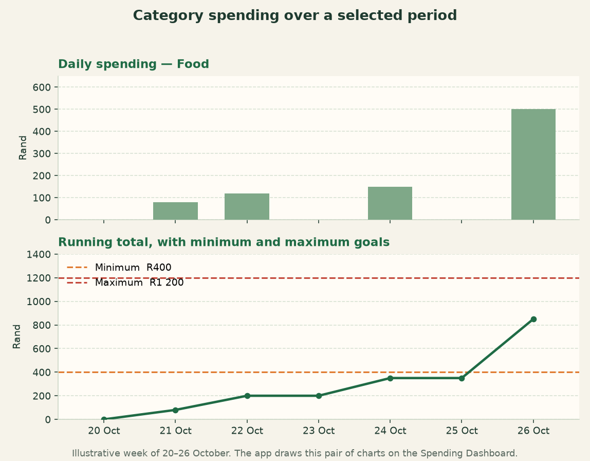
</p>

*Figure 10. Screenshot of the amount spent in one category over a user-selected period. The running total is read against the minimum and maximum goals (Barker, Davies and Singh, 2026j).*

Monthly goal progress is a related but distinct measure. Total expenditure for the preceding month is compared with the user’s minimum and maximum goals, allowing the interface to communicate whether spending is below, within or above the chosen range. Visual feedback should be accompanied by numeric amounts so that the user can understand the size of any difference without relying on colour alone. These calculations explain the functional relationship between transaction data, goal settings and the required financial visualisations; the final demonstration should show their operation in the submitted application. Figure 11 places one month’s total against that range. The Category Garden is shown in Figure 12.

<p align="center">
  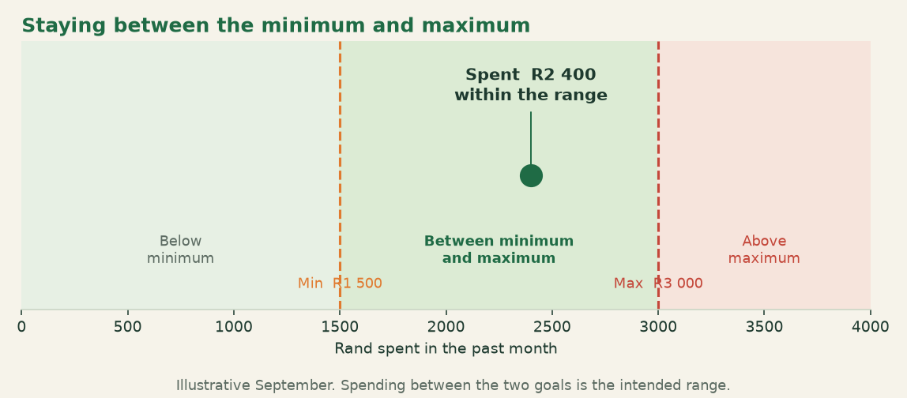
</p>

*Figure 11. Screenshot of how a past month compares with the minimum and maximum spending goals (Barker, Davies and Singh, 2026k).*

<p align="center">
  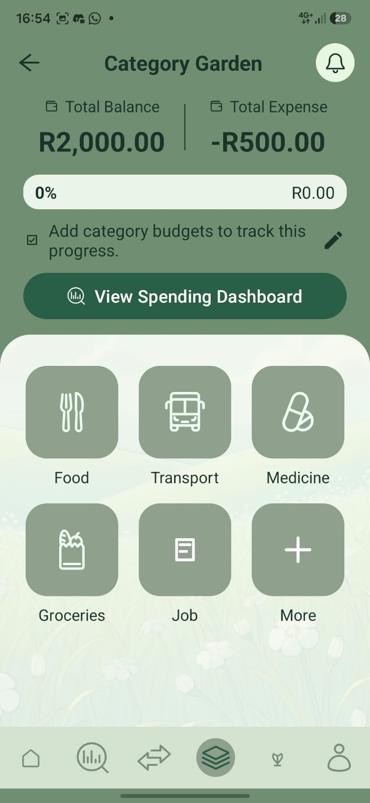
</p>

*Figure 12. Screenshot of the Category Garden, including the entry to the Spending Dashboard (Barker, Davies and Singh, 2026l).*

<a id="report-savings-and-financial-progress"></a>

#### Savings and financial progress

<p align="center">
  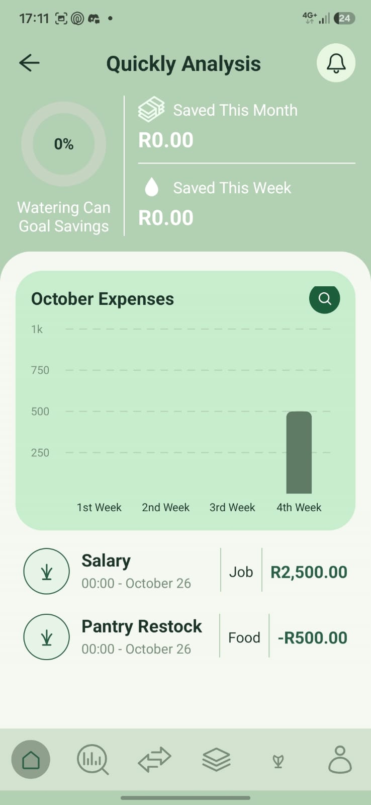
</p>

*Figure 13. Screenshot of Quickly Analysis. Savings progress sits beside a bar graph of the month's expenses by week (Barker, Davies and Singh, 2026m).*

Savings goals are managed independently from expenses and monthly spending limits. Users can create personalised savings goals, set optional target amounts, record contributions and review accumulated progress (Adepeju, et al., 2023). The Watering Can visual connects this process to the application's growth theme. Figure 13 shows savings progress beside a graph of the month’s expenses.

The Money Tree and Watering Can concepts establish a coherent metaphor for long-term financial development. Savings contributions are associated with gradual growth, while the underlying UserTree data model and persistence manager provide a technical foundation for storing tree-related state. This design links everyday financial decisions to a recognisable visual identity, supporting the broader objective of encouraging sustained engagement without obscuring the financial figures on which users rely.

<a id="report-two-additional-application-features"></a>

### Two additional application features

In addition to the core budgeting functionality and gamification elements, *MyMoneyTree* incorporates two independently developed features that extend the application's personalisation and account management capabilities. These features consist of profile picture cropping using the CanHub Android Image Cropper library and email-based password recovery through Firebase Authentication (CanHub, 2025). 

Both were selected as enhancements beyond the application's original functional requirements, addressing different aspects of the user experience. Profile picture cropping improves the flexibility and consistency of account personalisation, while email-based password recovery provides a more secure and accessible approach to account recovery. Unlike the Money Tree and Watering Can gamification systems, these features serve independent functional purposes and demonstrate the integration of additional Android and Firebase technologies.

<a id="report-additional-feature-1-profile-picture-cropping"></a>

#### Additional Feature 1: Profile picture cropping

<a id="report-purpose-and-design-considerations"></a>

##### Purpose and Design Considerations

Profile picture cropping was implemented to improve account personalisation while maintaining a consistent visual presentation throughout *MyMoneyTree*. Images captured using a device camera or selected from the gallery may contain unnecessary background elements, unsuitable proportions or excessively large dimensions. The cropping functionality allows users to select and adjust the portion of an image that will be displayed as their profile photograph. This feature supports the application's emphasis on personalisation and visual consistency by allowing users to customise their profiles without compromising the overall interface design (CanHub, 2025).

<a id="report-image-selection-and-cropping-implementation"></a>

##### Image Selection and Cropping Implementation

<p align="center">
  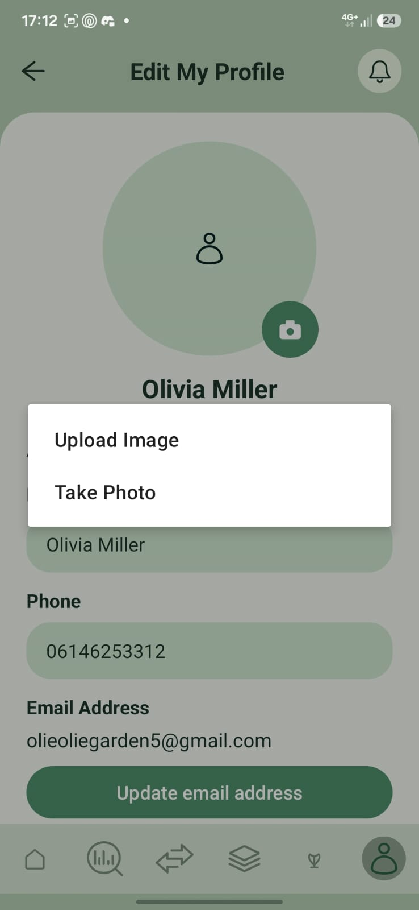
</p>

*Figure 14. Screenshot of Edit Profile, with the option to upload or take a photograph (Barker, Davies and Singh, 2026n).*

<p align="center">
  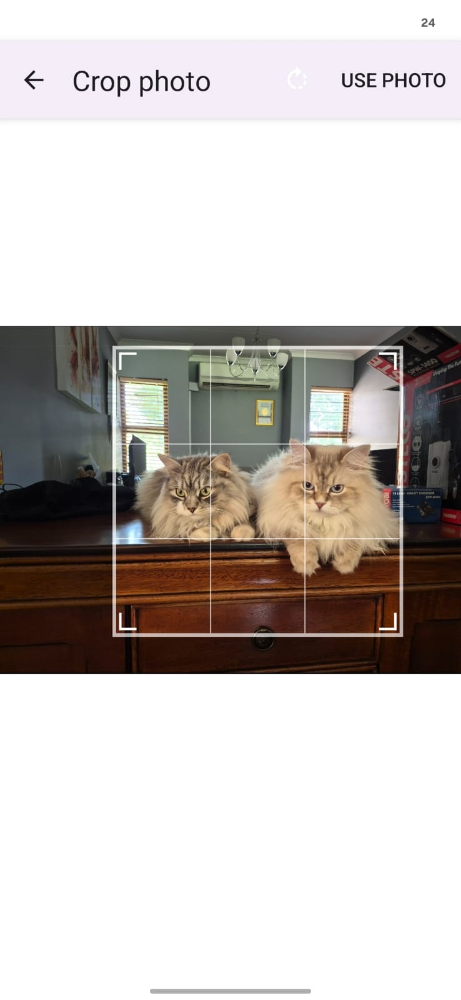
</p>

*Figure 15. Screenshot of the square crop of the selected profile photograph (Barker, Davies and Singh, 2026o).*

<p align="center">
  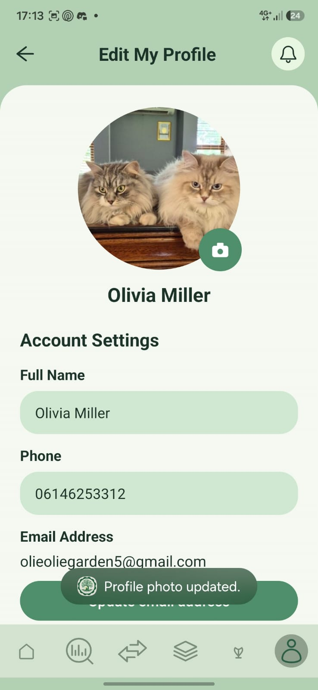
</p>

*Figure 16. Screenshot of the saved profile photograph on Edit Profile (Barker, Davies and Singh, 2026p).*

The cropping process is initiated through the Edit Profile interface, where users can select an existing photograph from the device gallery or capture a new image using the camera. The application integrates the CanHub Android Image Cropper library through CropImageContract within EditProfileActivity.kt.  Figures 14 to 16 show choosing a photograph, cropping it to a square and the saved profile image.

The library provides an interactive cropping interface with visual guidelines and a fixed aspect ratio of 1:1, allowing users to adjust the selected image within a square cropping area. Once the cropping operation is confirmed, the resulting image is processed and displayed within the application's circular profile avatar. If the operation is cancelled, the existing profile photograph remains unchanged. 

<a id="report-third-party-library-integration"></a>

##### Third-Party Library Integration

The cropping functionality uses CanHub Android Image Cropper, an open-source Android library distributed under the Apache License 2.0 licence. The library is integrated into the application through the Gradle dependency com.vanniktech:android-image-cropper:4.7.0. CanHub provides the interactive cropping interface and returns the cropped image, while *MyMoneyTree*'s implementation manages subsequent image compression, file-size validation and database storage. 

This separation allows the application to utilise established image-processing functionality while retaining control over how profile photographs are prepared and stored. The library's source code, documentation and licensing information are available at the following address: [https://github.com/CanHub/Android-Image-Cropper](https://github.com/CanHub/Android-Image-Cropper).

<a id="report-image-compression-and-validation"></a>

##### Image Compression and Validation

Following the cropping operation, the resulting image is processed using the ProfilePhoto.compress method. This method restricts the image's longest dimension to a maximum of 512 pixels by default and encodes the processed image in JPEG format at a quality setting of 85.

 Image compression reduces the storage requirements associated with profile photographs, while file-size validation ensures that the resulting image meets the application's maximum storage threshold of 500 KB. These operations serve separate but complementary purposes. Compression reduces the amount of image data, whereas validation determines whether the processed image satisfies the requirements for storage.

<a id="report-cloud-firestore-and-profile-integration"></a>

##### Cloud Firestore and Profile Integration

Once the image has been processed, the UserDatabaseSystem.updateProfilePhoto method validates its size and stores the accepted image data as a binary large object (Blob) in Cloud Firestore. The profile photograph is stored within the authenticated user's document structure at users/{uid}/profilePhoto/photo, where the Firebase user identifier associates the image with the relevant account (Firebase, 2026b; 2026f).

Unlike expense receipt photographs, which are retained in local device storage, profile photographs are stored online. This allows the saved profile image to be retrieved when the same account is accessed from another authenticated device. The ProfilePhoto component is responsible for displaying the saved image and presenting a default avatar when no profile photograph is available (Android Developers, 2026a).

<a id="report-error-handling-and-testing"></a>

##### Error Handling and Testing

The implementation accounts for situations in which a user cancels the cropping operation, selects invalid image data or attempts to save an image exceeding the permitted file size. Instrumentation tests support the verification of profile image storage, replacement and removal, including the handling of oversized images. These measures help maintain consistent application behaviour and reduce the likelihood of invalid image data being stored (Android Developers, 2026c).

Overall, profile picture cropping improves account personalisation while demonstrating the integration of a third-party Android library with application-specific image processing, validation and Firebase persistence. The principal implementation components include EditProfileActivity.kt, ProfilePhoto.kt and UserDatabaseSystem.kt.

<a id="report-additional-feature-2-email-based-password-recovery"></a>

#### Additional Feature 2: Email-based password recovery

<a id="report-purpose-and-design-considerations-2"></a>

##### Purpose and Design Considerations

Email-based password recovery was selected to provide users with a secure and accessible method of regaining access to their *MyMoneyTree* accounts when their passwords have been forgotten. As the application manages personal financial information, the recovery process must prioritise account security, accessibility and ease of use.

The feature builds on the application's existing Firebase Authentication integration, which manages user credentials independently of the financial information stored in Cloud Firestore. This approach avoids the need to store readable passwords within the application's database or develop a separate recovery mechanism involving security questions or recovery PINs.

<a id="report-password-recovery-process"></a>

##### Password Recovery Process

<p align="center">
  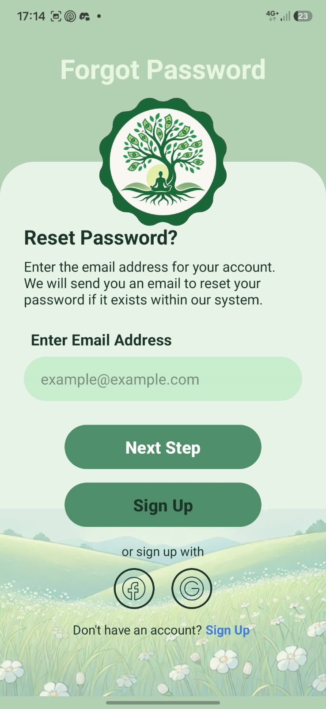
</p>

*Figure 17. Screenshot of the password recovery screen, reached from Forgot Password (Barker, Davies and Singh, 2026q).*

The password recovery process is designed to begin when a user selects the Forgot Password option from the application's sign-in interface. The user is directed to the recovery screen, where the email address associated with the registered account can be entered. Figure 17 shows this screen.

Following input validation, the application can submit a password-reset request through Firebase Authentication. The service generates and sends a recovery email containing a secure link to the configured password-reset interface. The account holder can then establish a new password before returning to *MyMoneyTree* and signing in using the updated credentials. This process enables users to restore account access without requiring the application to retrieve, disclose or directly manage their existing passwords.

<a id="report-firebase-authentication-integration"></a>

##### Firebase Authentication Integration

The recovery functionality is designed around the FirebaseAuth.sendPasswordResetEmail(email) method provided by the Firebase Authentication Android SDK. This method initiates a password-reset email request using the supplied email address and returns an asynchronous task. The application must handle the completion or failure of this task before communicating the outcome to the user.

Firebase Authentication is responsible for managing account credentials and password-reset operations, while Cloud Firestore remains responsible for storing the financial records, savings information and profile details associated with the authenticated account. This separation ensures that password recovery operates independently of the application's financial data management. Resetting an account password does not require the deletion or recreation of existing financial records.

<a id="report-input-validation-and-security-considerations"></a>

##### Input Validation and Security Considerations

Input validation is necessary to ensure that the supplied email address is not empty and follows an acceptable format before a recovery request is submitted.The recovery interface must also provide appropriate feedback when a request cannot be completed because of invalid input, network connectivity problems or authentication-related errors.

An additional security consideration involves limiting the disclosure of account information. Recovery responses should avoid unnecessarily revealing whether a particular email address is registered, reducing the potential for account enumeration. The handling of these responses depends on the application's error-management logic and the Firebase Authentication project's configuration. These considerations support a recovery process that balances usability with the protection of sensitive account information.

<a id="report-application-implementation"></a>

##### Application Implementation

The ForgotPasswordActivity.kt component provides the password recovery interface and establishes the entry point for the recovery functionality. When a user submits an email address, the activity calls UserDatabaseSystem.sendPasswordRecoveryEmail. That method checks that the address is not empty and is a valid email address, then invokes FirebaseAuth.sendPasswordResetEmail(email). If Firebase accepts the request, the application opens RecoverySentActivity and tells the user that a recovery email is sent when an account exists for that address. Send again stays unavailable for 60 seconds so the same address is not mailed repeatedly.

The recovery form is connected to Firebase Authentication. The application validates the supplied email address, waits for the asynchronous request to finish, and then shows confirmation or an error message. An empty or invalid address is rejected before a request is sent. No internet connection and too many attempts are reported to the user. A successful response is not treated as proof that the address is registered, which avoids revealing which email addresses have accounts.

<a id="report-contribution-to-application-usability-and-security"></a>

##### Contribution to Application Usability and Security

Email-based password recovery supports *MyMoneyTree'*s objective of providing an accessible and dependable personal financial management environment. A secure recovery mechanism reduces the inconvenience associated with forgotten credentials while maintaining the separation between account authentication and financial data storage.

The use of Firebase Authentication also supports the application's technical architecture by centralising credential management within the same service responsible for registration and sign-in.The principal application component associated with this feature is ForgotPasswordActivity.kt.

The official Firebase Authentication documentation is available at: [https://firebase.google.com/docs/auth/android/manage-users](https://firebase.google.com/docs/auth/android/manage-users).

<a id="report-technical-architecture-and-data-management"></a>

### Technical architecture and data management

<p align="center">
  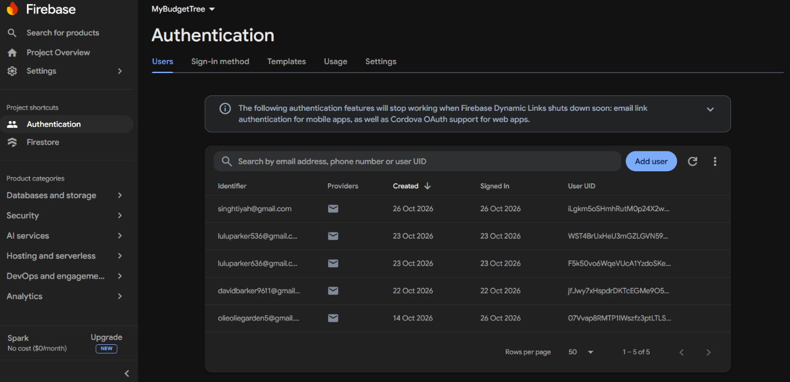
</p>

*Figure 18. Screenshot of the Firebase Authentication console showing registered users (Barker, Davies and Singh, 2026r).*

<p align="center">
  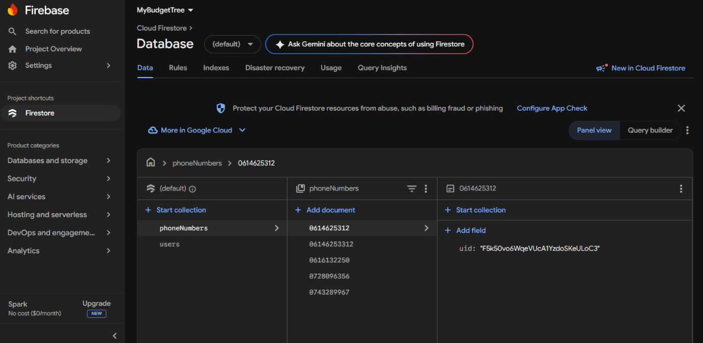
</p>

*Figure 19. Screenshot of the Cloud Firestore console showing online user data for MyBudgetTree (Barker, Davies and Singh, 2026s).*

My Money Tree is a native Android application written in Kotlin. The interface is composed of Android Activities and XML layouts. Screen-level code communicates with database manager classes, while application-wide setup initialises the services required by the project. The app uses asynchronous Firebase operations and Kotlin coroutines where supported by the relevant managers (Android Developers, 2026b; 2026h).

The backend separates two responsibilities. Firebase Authentication manages user identities and credentials. Cloud Firestore stores structured user data such as categories, expenses, income, monthly goals, savings goals, contributions, profile information and tree state. The main documents are organised under the authenticated user's *users/{uid}* path, allowing the application to associate records with the correct account (Firebase, 2026b).

The repository contains Firestore security rules designed to associate access permissions with authenticated user identities. Security rules form part of the backend configuration and are applied through Firebase deployment. Structured financial records are stored in Cloud Firestore, whereas receipt photographs are stored locally on the Android device. The resulting architecture therefore combines cloud-backed financial data with device-local supporting images, rather than a Room-based offline persistence layer (Android Developers, 2026l).

The online data flow begins when Firebase Authentication establishes a user session. The application then uses the authenticated uid to address the appropriate Firestore documents through its database manager classes. Creating or editing a financial record involves validating user input, mapping the entry to the application’s data model and writing the corresponding document. Reading records retrieves the user-specific documents for display in transaction lists, summaries and financial analysis. Receipt photographs remain an exception to cloud synchronisation because their image files are retained in device-local storage.

| Component | Technology | Responsibility |
| --- | --- | --- |
| User interface | Kotlin Activities and Android XML | Forms, navigation and financial views |
| Authentication | Firebase Authentication | Registration, sign-in and account identity |
| Financial records | Cloud Firestore | Online user-specific transaction, budget and savings data |
| Profile image | CanHub cropper and Firestore Blob | Square crop, compression and synced profile image |
| Receipt photographs | Android device-local storage | Locally retained supporting receipt images |

Table 2. Technology choices and data responsibilities (Firebase, 2026f; Material Components, 2026).

| Operation | Processing and storage | Design significance |
| --- | --- | --- |
| Sign in | Firebase Authentication validates email/password and supplies the authenticated uid. | Financial records are associated with a user identity rather than an anonymous device. |
| Record an expense | An Android form collects amount, date, category and description; a database manager writes the structured record to Cloud Firestore. | Transactions remain available as structured data for history and calculations. |
| Review category spending | Expense records are filtered by the chosen period, grouped by category and summed. | Users can interpret spending patterns against their goals. |
| Attach a receipt | The image is stored in device-private storage; the transaction retains the relevant local reference. | Receipt availability is device-dependent even when the transaction record is cloud-backed. |
| Update profile image | CanHub crop result ; then  JPEG compression ; then  500 KB validation ; then  Firestore Blob at users/{uid}/profilePhoto/photo. | Provides a consistent avatar and cloud-backed profile personalisation. |

*Table 3. Financial record and image data flows.*

<a id="report-utilisation-of-github-collaboration-and-version-control"></a>

### Utilisation of GitHub: collaboration and version control

<p align="center">
  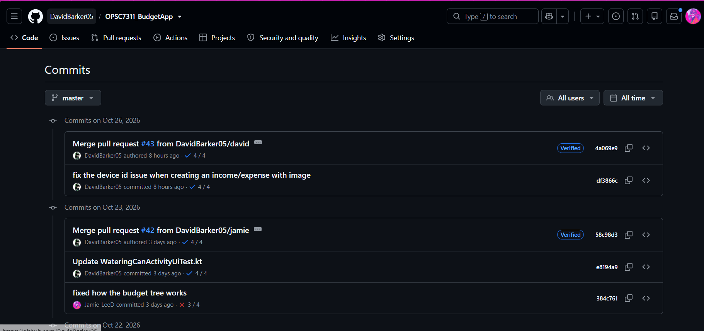
</p>

*Figure 20. Screenshot of the GitHub commit history for the shared repository (Barker, Davies and Singh, 2026t).*

Link to GitHub:  [https://github.com/DavidBarker05/OPSC7311_BudgetApp](https://github.com/DavidBarker05/OPSC7311_BudgetApp) (Barker, 2026).

GitHub serves as the project's shared development repository and provides a traceable history of its implementation. Git records changes to Kotlin classes, XML layouts, drawable resources, Gradle configuration, test suites and documentation. This enables the team to identify when changes were introduced, coordinate work on a common codebase and revisit earlier revisions if a problem emerges (GitHub, 2026a).

The repository is hosted at DavidBarker05/OPSC7311_BudgetApp, with master used as its principal branch in the documented development structure. Commit history provides an auditable account of changes to source code and project resources. This is particularly useful in collaborative development because modifications to shared database classes, models and interfaces can be traced to specific revisions (Barker, 2026). 

Version control is particularly important for an Android application involving multiple interacting components. A change to a model or database manager can affect forms, analysis calculations, account operations and automated tests. Keeping related changes in a versioned repository makes regressions easier to investigate and gives the team a shared reference for the build being demonstrated.

The responsibilities of these technologies are distinct. GitHub stores the source code, documentation and revision history; Gradle assembles the Android application into an APK; and Firebase supplies authentication and online data storage. Maintaining these responsibilities separately supports an organised and reproducible development process (Android Developers, 2026d). Figures 18 and 19 show the Firebase Authentication and Firestore consoles. Figure 20 shows recent commits on the shared repository. Figure 21 shows the GitHub Actions checks on a merged pull request.

<a id="report-utilisation-of-github-actions-automated-build-and-testing"></a>

### Utilisation of GitHub Actions: automated build and testing

<p align="center">
  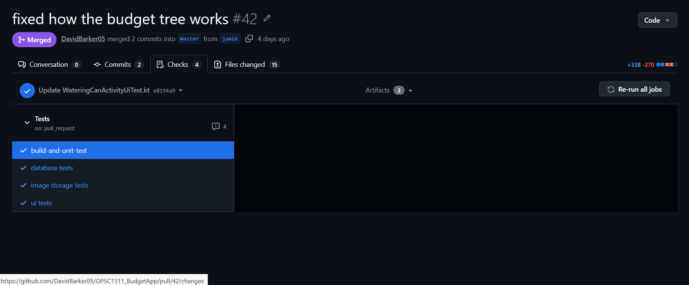
</p>

*Figure 21. Screenshot of the GitHub Actions checks on a merged pull request (Barker, Davies and Singh, 2026u).*

GitHub Actions extends the repository through a repeatable automated testing and build workflow configured for activity on master. The workflow helps identify compilation failures and functional regressions independently of individual Android Studio installations, thereby supporting consistent integration of contributions from multiple developers (GitHub, 2026b).

The workflow establishes the required Java and Android build environment, assembles the debug application and executes the project’s configured automated tests. Local JVM tests assess isolated calculations and helper behaviour, including currency formatting, budget status, category ordering and analysis-period calculations. Android instrumentation tests address account and profile operations, categories, income and expenses, monthly spending goals, savings contributions, tree-state management and related database behaviour. Additional tests cover saving, retrieving and deleting device-local images, while Espresso interface tests exercise sign-in and navigation across the Home, Analysis, Transactions, Categories, Watering Can and Profile screens (Android Developers, 2026c; 2026f).

Database and interface tests use Firebase Authentication and Cloud Firestore emulators, enabling test accounts and financial records to be exercised in a controlled environment. Emulator configuration and disposable test data reduce reliance on production information, while GitHub Actions logs and generated build artefacts preserve a record of workflow execution (Firebase, 2026d).

Continuous integration strengthens the development process by combining reproducible builds, automated regression checks and a central record of test executions. For *MyMoneyTree*, this is especially relevant to financial calculations, authentication and database interactions, where changes in one component can affect the behaviour of several screens.

| Workflow stage | Role in the project |
| --- | --- |
| **Gradle build** | Checks that Android source and resources can be assembled |
| **JVM unit tests** | Checks isolated calculations and helper logic |
| **Instrumentation tests** | Checks Android-specific application behaviour |
| **Firebase emulator tests** | Exercises backend interactions with disposable test data |
| **Debug APK output** | Provides a build artefact for subsequent testing |

Table 4. GitHub Actions workflow and its development purpose (Android Developers, 2026d; 2026f; Firebase, 2026d).

<a id="report-final-demonstration-video-and-project-resources"></a>

### Final demonstration video and project resources

The final demonstration video presents the Android application and its core financial workflows, including account access, transaction management, spending goals, savings and profile personalisation. 

The final Part 3 demonstration video is available at the following location: [https://youtu.be/Aa6gIzrsJUg](https://youtu.be/Aa6gIzrsJUg) (Barker, Davies and Singh, 2026v).

Email addresses and phone numbers have been blurred in this version to comply with YouTube's policies and prevent the video from being removed (YouTube, 2026). The originally uploaded, unblurred video has also been submitted to YouTube for review and can be viewed here: [https://youtu.be/YX4kl3HJrK8](https://youtu.be/YX4kl3HJrK8) if the ban is lifted (Barker, Davies and Singh, 2026w).

If these details are required for assessment, please refer to the original, unblurred video included as a ZIP file in our project submission.

Alternatively, the full, unedited demonstration can be accessed on google drive here: [https://drive.google.com/file/d/1JJdNtyJUkjCJBW4mlWuYFpRuhMleFUxk/view?usp=sharing](https://drive.google.com/file/d/1JJdNtyJUkjCJBW4mlWuYFpRuhMleFUxk/view?usp=sharing) 

<a id="report-conclusion"></a>

### Conclusion

*My Money Tree* was developed around the belief that financial management should be both useful and approachable. The research phase established the value of structured budgeting, meaningful financial reporting and intuitive interaction. The planning phase translated these findings into the Financial Sanctuary concept, where the visual language of growth supports a more serene relationship with finances without compromising financial clarity, accuracy and functionality.

The implementation brings this concept into a Kotlin Android application with Firebase-backed accounts, transaction and category management, monthly goals, savings tracking and personalisation. GitHub supports the organisation and traceability of the team's work, while GitHub Actions provides repeatable build and testing evidence. Together, these technical and design decisions demonstrate an attempt to balance functionality, reliability and a distinctive user experience.

<a id="report-references"></a>

### References

Adepeju, A.S., Ojuade, S., Eneh, F.I., Olisa, A.O. and Odozor, L.A., 2023. Gamification of savings and investment products. *Research Journal in Business and Economics*, [e-journal] 1(1), pp.88–100. Available at: &lt;[https://doi.org/10.61424/rjbe.v1i1.437](https://doi.org/10.61424/rjbe.v1i1.437)&gt; [Accessed 11 September 2026].

Android Developers, 2026a. Access app-specific files. [online] Available at: &lt;[https://developer.android.com/training/data-storage/app-specific](https://developer.android.com/training/data-storage/app-specific)&gt; [Accessed 8 September 2026].

Android Developers, 2026b. Best practices for coroutines in Android. [online] Available at: &lt;[https://developer.android.com/kotlin/coroutines/coroutines-best-practices](https://developer.android.com/kotlin/coroutines/coroutines-best-practices)&gt; [Accessed 10 September 2026].

Android Developers, 2026c. Build instrumented tests. [online] Available at: &lt;[https://developer.android.com/training/testing/instrumented-tests](https://developer.android.com/training/testing/instrumented-tests)&gt; [Accessed 15 September 2026].

Android Developers, 2026d. Configure your build. [online] Available at: &lt;[https://developer.android.com/build](https://developer.android.com/build)&gt; [Accessed 15 September 2026].

Android Developers, 2026e. Data and file storage overview. [online] Available at: &lt;[https://developer.android.com/training/data-storage](https://developer.android.com/training/data-storage)&gt; [Accessed 8 September 2026].

Android Developers, 2026f. Espresso. [online] Available at: &lt;[https://developer.android.com/training/testing/espresso](https://developer.android.com/training/testing/espresso)&gt; [Accessed 15 September 2026].

Android Developers, 2026g. Introduction to activities. [online] Available at: &lt;[https://developer.android.com/guide/components/activities/intro-activities](https://developer.android.com/guide/components/activities/intro-activities)&gt; [Accessed 7 September 2026].

Android Developers, 2026h. Kotlin and Android. [online] Available at: &lt;[https://developer.android.com/kotlin](https://developer.android.com/kotlin)&gt; [Accessed 7 September 2026].

Android Developers, 2026i. Layouts in views. [online] Available at: &lt;[https://developer.android.com/develop/ui/views/layout/declaring-layout](https://developer.android.com/develop/ui/views/layout/declaring-layout)&gt; [Accessed 7 September 2026].

Android Developers, 2026j. Navigation. [online] Available at: &lt;[https://developer.android.com/guide/navigation](https://developer.android.com/guide/navigation)&gt; [Accessed 6 September 2026].

Android Developers, 2026k. Principles for improving app accessibility. [online] Available at: &lt;[https://developer.android.com/guide/topics/ui/accessibility/principles](https://developer.android.com/guide/topics/ui/accessibility/principles)&gt; [Accessed 6 September 2026].

Android Developers, 2026l. Save data in a local database using Room. [online] Available at: &lt;[https://developer.android.com/training/data-storage/room](https://developer.android.com/training/data-storage/room)&gt; [Accessed 10 September 2026].

Barker, D., 2026. OPSC7311 budget app. [source code] Available at: &lt;[https://github.com/DavidBarker05/OPSC7311_BudgetApp](https://github.com/DavidBarker05/OPSC7311_BudgetApp)&gt; [Accessed 16 September 2026].

Barker, D., Davies, J.L. and Singh, T., 2026a. Screenshot of the application icon for My Money Tree. [screenshot] (Personal collection). Johannesburg: Unpublished.

Barker, D., Davies, J.L. and Singh, T., 2026b. Screenshot of the splash screen with the MyMoneyTree logo and tagline. [screenshot] (Personal collection). Johannesburg: Unpublished.

Barker, D., Davies, J.L. and Singh, T., 2026c. Screenshot of the home dashboard showing balance totals and savings progress. [screenshot] (Personal collection). Johannesburg: Unpublished.

Barker, D., Davies, J.L. and Singh, T., 2026d. Screenshot of the Goals tab showing the shared Money Tree. [screenshot] (Personal collection). Johannesburg: Unpublished.

Barker, D., Davies, J.L. and Singh, T., 2026e. Screenshot of the Goals tab scrolled to a goal's watering can. [screenshot] (Personal collection). Johannesburg: Unpublished.

Barker, D., Davies, J.L. and Singh, T., 2026f. Screenshot of the Create Account screen. [screenshot] (Personal collection). Johannesburg: Unpublished.

Barker, D., Davies, J.L. and Singh, T., 2026g. Screenshot of the sign-in screen. [screenshot] (Personal collection). Johannesburg: Unpublished.

Barker, D., Davies, J.L. and Singh, T., 2026h. Screenshot of the analysis screen with income and expenses graphed over a selected period. [screenshot] (Personal collection). Johannesburg: Unpublished.

Barker, D., Davies, J.L. and Singh, T., 2026i. Screenshot of the transaction list for the same period. [screenshot] (Personal collection). Johannesburg: Unpublished.

Barker, D., Davies, J.L. and Singh, T., 2026j. Screenshot of the amount spent in one category over a user-selected period. [screenshot] (Personal collection). Johannesburg: Unpublished.

Barker, D., Davies, J.L. and Singh, T., 2026k. Screenshot of how a past month compares with the minimum and maximum spending goals. [screenshot] (Personal collection). Johannesburg: Unpublished.

Barker, D., Davies, J.L. and Singh, T., 2026l. Screenshot of the Category Garden, including the entry to the Spending Dashboard. [screenshot] (Personal collection). Johannesburg: Unpublished.

Barker, D., Davies, J.L. and Singh, T., 2026m. Screenshot of Quickly Analysis, with savings progress beside a bar graph of the month's expenses by week. [screenshot] (Personal collection). Johannesburg: Unpublished.

Barker, D., Davies, J.L. and Singh, T., 2026n. Screenshot of Edit Profile, with the option to upload or take a photograph. [screenshot] (Personal collection). Johannesburg: Unpublished.

Barker, D., Davies, J.L. and Singh, T., 2026o. Screenshot of the square crop of the selected profile photograph. [screenshot] (Personal collection). Johannesburg: Unpublished.

Barker, D., Davies, J.L. and Singh, T., 2026p. Screenshot of the saved profile photograph on Edit Profile. [screenshot] (Personal collection). Johannesburg: Unpublished.

Barker, D., Davies, J.L. and Singh, T., 2026q. Screenshot of the password recovery screen, reached from Forgot Password. [screenshot] (Personal collection). Johannesburg: Unpublished.

Barker, D., Davies, J.L. and Singh, T., 2026r. Screenshot of the Firebase Authentication console showing registered users. [screenshot] (Personal collection). Johannesburg: Unpublished.

Barker, D., Davies, J.L. and Singh, T., 2026s. Screenshot of the Cloud Firestore console showing online user data for MyBudgetTree. [screenshot] (Personal collection). Johannesburg: Unpublished.

Barker, D., Davies, J.L. and Singh, T., 2026t. Screenshot of the GitHub commit history for the shared repository. [screenshot] (Personal collection). Johannesburg: Unpublished.

Barker, D., Davies, J.L. and Singh, T., 2026u. Screenshot of the GitHub Actions checks on a merged pull request. [screenshot] (Personal collection). Johannesburg: Unpublished.

Barker, D., Davies, J.L. and Singh, T., 2026v. MyMoneyTree Part 3 demonstration. [video online] Available at: &lt;[https://youtu.be/Aa6gIzrsJUg](https://youtu.be/Aa6gIzrsJUg)&gt; [Accessed 18 September 2026].

Barker, D., Davies, J.L. and Singh, T., 2026w. MyMoneyTree Part 3 demonstration (unblurred). [video online] Available at: &lt;[https://youtu.be/YX4kl3HJrK8](https://youtu.be/YX4kl3HJrK8)&gt; [Accessed 18 September 2026].

BudgetBakers, 2026. Wallet: personal and family finance manager. [online] Available at: &lt;[https://budgetbakers.com/en/products/wallet/](https://budgetbakers.com/en/products/wallet/)&gt; [Accessed 4 September 2026].

CanHub, 2025. Android image cropper (version 4.7.0). [source code] Available at: &lt;[https://github.com/CanHub/Android-Image-Cropper](https://github.com/CanHub/Android-Image-Cropper)&gt; [Accessed 9 September 2026].

Firebase, 2026a. Authenticate with Firebase using password-based accounts on Android. [online] Available at: &lt;[https://firebase.google.com/docs/auth/android/password-auth](https://firebase.google.com/docs/auth/android/password-auth)&gt; [Accessed 8 September 2026].

Firebase, 2026b. Get started with Cloud Firestore security rules. [online] Available at: &lt;[https://firebase.google.com/docs/firestore/security/get-started](https://firebase.google.com/docs/firestore/security/get-started)&gt; [Accessed 12 September 2026].

Firebase, 2026c. Get started with Firestore standard edition. [online] Available at: &lt;[https://firebase.google.com/docs/firestore/quickstart](https://firebase.google.com/docs/firestore/quickstart)&gt; [Accessed 12 September 2026].

Firebase, 2026d. Introduction to the Firebase local emulator suite. [online] Available at: &lt;[https://firebase.google.com/docs/emulator-suite](https://firebase.google.com/docs/emulator-suite)&gt; [Accessed 17 September 2026].

Firebase, 2026e. Manage users in Firebase. [online] Available at: &lt;[https://firebase.google.com/docs/auth/android/manage-users](https://firebase.google.com/docs/auth/android/manage-users)&gt; [Accessed 18 September 2026].

Firebase, 2026f. Supported data types. [online] Available at: &lt;[https://firebase.google.com/docs/firestore/manage-data/data-types](https://firebase.google.com/docs/firestore/manage-data/data-types)&gt; [Accessed 12 September 2026].

GitHub, 2026a. About Git. [online] Available at: &lt;[https://docs.github.com/en/get-started/using-git/about-git](https://docs.github.com/en/get-started/using-git/about-git)&gt; [Accessed 14 September 2026].

GitHub, 2026b. Building and testing Java with Gradle. [online] Available at: &lt;[https://docs.github.com/en/actions/tutorials/build-and-test-code/java-with-gradle](https://docs.github.com/en/actions/tutorials/build-and-test-code/java-with-gradle)&gt; [Accessed 14 September 2026].

Material Components, 2026. Material components for Android. [source code] Available at: &lt;[https://github.com/material-components/material-components-android](https://github.com/material-components/material-components-android)&gt; [Accessed 7 September 2026].

Mubashar, A. and Sarwar, S., 2025. Engagement through gamification: the role of fintech in enhancing user motivation for achieving financial goals. *Journal of Accounting and Finance Review*, [e-journal]. Available at: &lt;[https://doi.org/10.26652/jafr/24.02.002](https://doi.org/10.26652/jafr/24.02.002)&gt; [Accessed 6 September 2026].

Rizwan, M.S., Malik, A. and Hussain, S.M., 2026. Gamification in finance: a systematic review and research agenda. *Journal of Behavioral and Experimental Finance*, [e-journal] 50, p.101180. Available at: &lt;[https://doi.org/10.1016/j.jbef.2026.101180](https://doi.org/10.1016/j.jbef.2026.101180)&gt; [Accessed 12 September 2026].

Rodríguez-Correa, P.A., Arias García, S., Bermeo-Giraldo, M.C., Valencia-Arias, A., Martínez Rojas, E., Aurora Vigo, E.F. and Gallegos, A., 2025. Financial literacy among young college students: advancements and future directions. *F1000Research*, [e-journal] 14, article 113. Available at: &lt;[https://doi.org/10.12688/f1000research.159085.3](https://doi.org/10.12688/f1000research.159085.3)&gt; [Accessed 11 September 2026].

Spendee, 2026a. Money manager and budget planner. [online] Available at: &lt;[https://www.spendee.com/](https://www.spendee.com/)&gt; [Accessed 3 September 2026].

Spendee, 2026b. What is Spendee? [online] Available at: &lt;[https://help.spendee.com/article/114-what-is-spendee](https://help.spendee.com/article/114-what-is-spendee)&gt; [Accessed 3 September 2026].

YNAB, 2024. The YNAB method. [online] Available at: &lt;[https://www.ynab.com/ynab-method](https://www.ynab.com/ynab-method)&gt; [Accessed 3 September 2026].

YouTube, 2026. Harassment and cyberbullying policies. [online] Available at: &lt;[https://support.google.com/youtube/answer/2802268?hl=en](https://support.google.com/youtube/answer/2802268?hl=en)&gt; [Accessed 19 September 2026].
